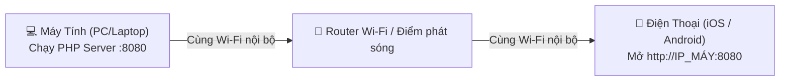

# 📖 HƯỚNG DẪN CÀI ĐẶT & CHẠY WEB TRUYỆN TỪ A ĐẾN Z
### Dành cho cả Máy Tính (PC / Laptop) và Điện Thoại (iOS / Android)
**Dự án:** Website Đọc Truyện Zhihu — *Mướp Đắng Cũng Có Vị Ngọt*

---

## 1. YÊU CẦU HỆ THỐNG & CÁC PHẦN MỀM CẦN TẢI

Dự án được xây dựng trên nền tảng **WordPress Core tùy biến (PHP 8.2 + MySQL)** độc lập, nhẹ và tối ưu hóa cao. Bạn chỉ cần chuẩn bị:

| Phần mềm / Công cụ | Phiên bản khuyến nghị | Mục đích sử dụng | Link tải chính thức |
| :--- | :--- | :--- | :--- |
| **XAMPP for Windows** | Phiên bản có **PHP 8.1 hoặc PHP 8.2** | Cung cấp MySQL Database Server và PHP Engine | [apachefriends.org](https://www.apachefriends.org/download.html) |
| **Trình duyệt Web** | Chrome, Edge, Safari, Brave, Firefox... | Dùng để lướt web trên máy tính & điện thoại | Có sẵn trên thiết bị |
| **Git** *(Không bắt buộc)* | Bản mới nhất | Dùng để clone mã nguồn nếu không tải file ZIP | [git-scm.com](https://git-scm.com/) |

> [!TIP]
> Nếu máy tính đã có cài sẵn XAMPP (hoặc PHP 8.2 + MySQL độc lập), bạn hoàn toàn không cần cài đặt lại!

---

## 2. TẢI SOURCE CODE & CHUẨN BỊ THƯ MỤC

### Cách 1: Tải dạng file nén ZIP (Đơn giản nhất)
1. Tải file ZIP mã nguồn về máy tính.
2. Nhấp chuột phải vào file ZIP vừa tải về -> Chọn **Extract All...** (Giải nén).
3. Đặt thư mục tại một ổ đĩa thuận tiện, ví dụ:
   - `D:\WEB-APP RIENG\WEB-TRUYEN-ZHIHU`
   - Hoặc `C:\xampp\htdocs\webtruyen`

### Cách 2: Dùng lệnh Git Clone
Mở **Command Prompt (cmd)** hoặc **PowerShell** và gõ lệnh:
```bash
git clone <URL_REPO_CỦA_BẠN> "D:\WEB-APP RIENG\WEB-TRUYEN-ZHIHU"
```

---

## 3. CÀI ĐẶT XAMPP & MÔI TRƯỜNG PHP/MYSQL

Nếu máy tính của bạn chưa có XAMPP:

1. **Tải bộ cài đặt:** Truy cập [https://www.apachefriends.org/download.html](https://www.apachefriends.org/download.html), tải bản cài đặt XAMPP dành cho Windows (chọn bản có PHP 8.2.x).
2. **Tiến hành cài đặt:**
   - Chạy file `.exe` vừa tải. Nếu có thông báo UAC, bấm **OK**.
   - Tại màn hình chọn thành phần (Components), chỉ cần tích chọn: **Apache**, **MySQL**, **PHP**, **phpMyAdmin**.
   - Chọn thư mục cài đặt mặc định: `C:\xampp` (hoặc `C:\Program Files\xampp`).
   - Bấm **Next** cho đến khi hoàn tất cài đặt.
3. **Thêm PHP vào biến môi trường (PATH) của Windows:**
   - Nhấn phím `Windows` trên bàn phím, gõ **Environment Variables**, chọn **Edit the system environment variables**.
   - Bấm nút **Environment Variables...**.
   - Tại mục **System variables**, tìm dòng `Path` -> Bấm **Edit**.
   - Bấm nút **New** -> Dán đường dẫn thư mục PHP của XAMPP vào (thường là `C:\xampp\php` hoặc `C:\Program Files\xampp\php`).
   - Bấm **OK** để lưu lại.

---

## 4. TẢI & NẠP CƠ SỞ DỮ LIỆU (IMPORT DATABASE)

Trong thư mục source code đã được tích hợp sẵn 2 file sao lưu dữ liệu đầy đủ:
- `backup_latest.sql`: Bản sao lưu dữ liệu mới nhất (chứa đầy đủ truyện, chương, tủ truyện, tài khoản mẫu).
- `database.sql`: Bản sao lưu cơ sở dữ liệu chuẩn ban đầu.

Bạn có thể nạp dữ liệu vào MySQL theo 1 trong 2 cách sau:

### Cách 1: Nạp tự động bằng 1-Click (Khuyên dùng)
1. Mở thư mục mã nguồn website.
2. Tìm và click đúp chuột vào file **`sync_database_to_xampp.bat`**.
3. Cửa sổ cmd sẽ tự động nạp toàn bộ dữ liệu từ `backup_latest.sql` vào cơ sở dữ liệu `webtruyen_zhihu` của bạn.
4. Khi màn hình hiện `[OK] Da dong bo toan bo du lieu...` là thành công!

---

### Cách 2: Nạp thủ công qua giao diện phpMyAdmin
1. Mở **XAMPP Control Panel** -> Bấm nút **Start** tại dòng **MySQL**.
2. Mở trình duyệt web và truy cập địa chỉ: [http://localhost/phpmyadmin/](http://localhost/phpmyadmin/)
3. **Tạo Database mới:**
   - Bấm vào mục **Mới (New)** ở cột bên trái.
   - Nhập tên cơ sở dữ liệu: `webtruyen_zhihu`
   - Bảng mã (Collation): Chọn `utf8mb4_general_ci` hoặc `utf8mb4_unicode_ci`.
   - Bấm nút **Tạo (Create)**.
4. **Nạp dữ liệu (Import):**
   - Click chọn database `webtruyen_zhihu` vừa tạo ở cột bên trái.
   - Chuyển sang thẻ **Nhập (Import)** ở menu phía trên.
   - Tại mục **Tệp để nhập (File to import)**, bấm nút **Choose File** (Chọn tệp) và tìm đến file `backup_latest.sql` trong thư mục source code.
   - Kéo xuống dưới cùng và bấm nút **Nhập (Import)**.
   - Đợi khoảng 10 - 20 giây, hệ thống sẽ hiện thông báo màu xanh báo nạp thành công 15 bảng dữ liệu.

---

## 5. CÁCH KHỞI CHẠY WEBSITE TRÊN MÁY TÍNH (PC / LAPTOP)

### Cách 1: Chạy Siêu Tốc Bằng File `run.bat` (Khuyên dùng nhất)
Chỉ cần **1 cú click chuột**:
1. Vào thư mục dự án, tìm file **`run.bat`**.
2. Click đúp vào file `run.bat`.
3. File tự động thực hiện:
   - Tự kiểm tra và khởi động MySQL Server (Port 3306).
   - Tự khởi động PHP Built-in Server trên cổng `8080` (lắng nghe mọi IP qua `0.0.0.0:8080`).
   - Tự động lấy địa chỉ IP mạng nội bộ (LAN IP) của máy tính bạn.
   - Tự động mở trình duyệt web hiển thị trang chủ website: `http://localhost:8080/`.
   - Tự động mở trang tạo mã QR hỗ trợ điện thoại kết nối: `http://localhost:8080/utilities/mobile.html?ip=<IP_MÁY>`.

> [!NOTE]
> Cửa sổ đen cmd của `run.bat` (hoặc tiến trình nền) cần được giữ hoạt động trong suốt quá trình bạn lướt web. Khi không dùng nữa, bạn chỉ việc đóng cửa sổ cmd lại.

---

### Cách 2: Khởi chạy thủ công qua Terminal / PowerShell
1. Bật MySQL trong XAMPP Control Panel (hoặc đảm bảo cổng 3306 đang chạy).
2. Mở **PowerShell** hoặc **Command Prompt** tại thư mục dự án (`D:\WEB-APP RIENG\WEB-TRUYEN-ZHIHU`).
3. Chạy câu lệnh sau:
   ```bash
   php -S 0.0.0.0:8080 router.php
   ```
4. Mở trình duyệt trên máy tính và truy cập:
   - [http://localhost:8080/](http://localhost:8080/)

---

## 6. CÁCH KẾT NỐI & ĐỌC TRUYỆN TRÊN ĐIỆN THOẠI

Bạn có thể đọc truyện mượt mà trên iPhone, iPad, Android với trải nghiệm giao diện di động tối ưu:



### Bước 1: Điều kiện tiên quyết
- **Điện thoại và Máy tính BẮT BUỘC phải kết nối vào cùng 1 mạng Wi-Fi.**
- *(Nếu không có Wi-Fi, bạn có thể bật "Điểm phát sóng di động" (Personal Hotspot) trên điện thoại, sau đó cho máy tính kết nối vào Wi-Fi của điện thoại).*

### Bước 2: Lấy địa chỉ IP mạng LAN của máy tính
- **Cách xem tự động:** Khi bạn chạy file `run.bat`, màn hình sẽ in sẵn IP (Ví dụ: `192.168.1.182`).
- **Cách xem thủ công:**
  1. Trên máy tính, bấm tổ hợp phím `Win + R`, gõ `cmd` rồi bấm Enter.
  2. Gõ lệnh: `ipconfig` và ấn Enter.
  3. Tìm đến mục **Wireless LAN adapter Wi-Fi** (hoặc **Ethernet**), nhìn dòng **IPv4 Address**. Địa chỉ sẽ có dạng: `192.168.x.x` (Ví dụ: `192.168.1.182`).

### Bước 3: Truy cập từ điện thoại
Chọn 1 trong 2 cách sau:

#### 👉 Cách A: Quét mã QR cực nhanh (Khuyên dùng)
1. Trên máy tính, mở trang:
   `http://localhost:8080/utilities/mobile.html?ip=192.168.1.182` *(thay bằng IP máy của bạn)*.
2. Mở Camera hoặc ứng dụng Quét mã QR trên điện thoại -> Hướng vào màn hình máy tính để quét mã QR.
3. Bấm vào liên kết hiện lên để vào trang web ngay!

#### 👉 Cách B: Nhập trực tiếp địa chỉ vào trình duyệt điện thoại
1. Mở trình duyệt Safari (iPhone) hoặc Chrome (Android) trên điện thoại.
2. Nhập vào thanh địa chỉ:
   ```
   http://192.168.1.182:8080/
   ```
   *(Thay `192.168.1.182` bằng IP máy tính của bạn)*.
3. Bấm **Đi (Go)** để truy cập. Giao diện sẽ tự động co giãn đẹp mắt theo kích thước màn hình điện thoại!

---

## 7. DANH SÁCH TÀI KHOẢN MẪU ĐỂ TRẢI NGHIỆM

Hệ thống đã có sẵn các tài khoản demo tương ứng với 3 vai trò khác nhau trong hệ thống:

| Vai trò | Tên đăng nhập | Mật khẩu | Chức năng nổi bật |
| :--- | :--- | :--- | :--- |
| **Quản trị viên (Admin)** | `admin` | `Ngockha2405` | Toàn quyền quản trị website, duyệt truyện của dịch giả, quản lý link Shopee/TikTok affiliate, xem bảng lương, quản lý người dùng, chuyển đổi chế độ xem. |
| **Dịch giả (Translator)** | `dichgia_muop` | `dichgia123` | Đăng truyện mới, thêm chương, quét kiểm duyệt từ nhạy cảm tự động, xem thống kê lượt đọc, theo dõi tiền nhuận bút (8đ / view). |
| **Độc giả (Reader)** | `docgia_linh` | `docgia123` | Đọc truyện, đánh dấu chương đã đọc, lưu vào tủ truyện yêu thích, đổi chế độ giao diện Sáng/Tối (Light/Dark mode), bình luận truyện. |

> Đường dẫn đăng nhập nhanh: [http://localhost:8080/dang-nhap/](http://localhost:8080/dang-nhap/)

---

## 8. KHẮC PHỤC CÁC LỖI THƯỜNG GẶP (TROUBLESHOOTING)

### 🔴 Lỗi 1: Điện thoại không tải được web, báo "Không thể kết nối" hoặc tải vô tận
* **Nguyên nhân chính:** Tường lửa của Windows (Windows Defender Firewall) đang chặn kết nối đến cổng `8080` từ các thiết bị bên ngoài.
* **Cách khắc phục nhanh:**
  1. Mở **PowerShell bằng quyền Administrator** (Nhấn phím `Windows`, gõ `PowerShell`, chuột phải chọn **Run as administrator**).
  2. Dán dòng lệnh sau vào và bấm Enter để mở cổng 8080:
     ```powershell
     New-NetFirewallRule -DisplayName "Cho phep PHP Web Server Port 8080" -Direction Inbound -LocalPort 8080 -Protocol TCP -Action Allow
     ```
  3. Kiểm tra lại xem điện thoại và máy tính đã kết nối chung một mạng Wi-Fi hay chưa.

---

### 🔴 Lỗi 2: MySQL của XAMPP bị lỗi không thể Start (Báo đỏ hoặc tắt ngay lập tức)
* **Nguyên nhân:** Thường do Windows bị sập nguồn đột ngột làm hỏng file tạm `aria_log` hoặc file khóa `mysql.pid` của MariaDB/MySQL.
* **Cách khắc phục:**
  1. Trong thư mục dự án, nhấp chuột phải vào file **`fix_mysql.bat`** (hoặc `fix_mysql_xampp.bat`).
  2. Chọn **Run as administrator** (Chạy với quyền quản trị viên).
  3. Đợi script tự động dọn dẹp các file rác và cấp lại quyền ghi cho thư mục `data`.
  4. Mở lại XAMPP và bấm nút **Start** MySQL là sẽ chạy bình thường.

---

### 🔴 Lỗi 3: Lỗi báo "Error establishing a database connection" khi mở web
* **Nguyên nhân:** MySQL chưa được khởi động, hoặc chưa import database `webtruyen_zhihu`.
* **Cách khắc phục:**
  1. Mở XAMPP Control Panel kiểm tra xem nút cạnh chữ **MySQL** đã có màu xanh lá và hiển thị `Port 3306` chưa.
  2. Vào `http://localhost/phpmyadmin/` kiểm tra xem đã có database tên `webtruyen_zhihu` với các bảng như `wp_posts`, `wp_users` hay chưa. Nếu chưa có, xem lại [Mục 4](#4-tải--nạp-cơ-sở-dữ-liệu-import-database).

---

### 🔴 Lỗi 4: Báo lỗi "Address already in use" (Cổng 8080 bị chiếm dụng)
* **Nguyên nhân:** Có một ứng dụng khác trên máy (hoặc một tiến trình PHP cũ) đang chạy ngầm trên cổng 8080.
* **Cách khắc phục:**
  1. Mở PowerShell gõ lệnh:
     ```powershell
     Get-Process -Id (Get-NetTCPConnection -LocalPort 8080).OwningProcess | Stop-Process -Force
     ```
  2. Chạy lại file `run.bat`.

---

**Chúc bạn cài đặt và trải nghiệm website "Mướp Đắng Cũng Có Vị Ngọt" thật tuyệt vời! 🥒✨**
